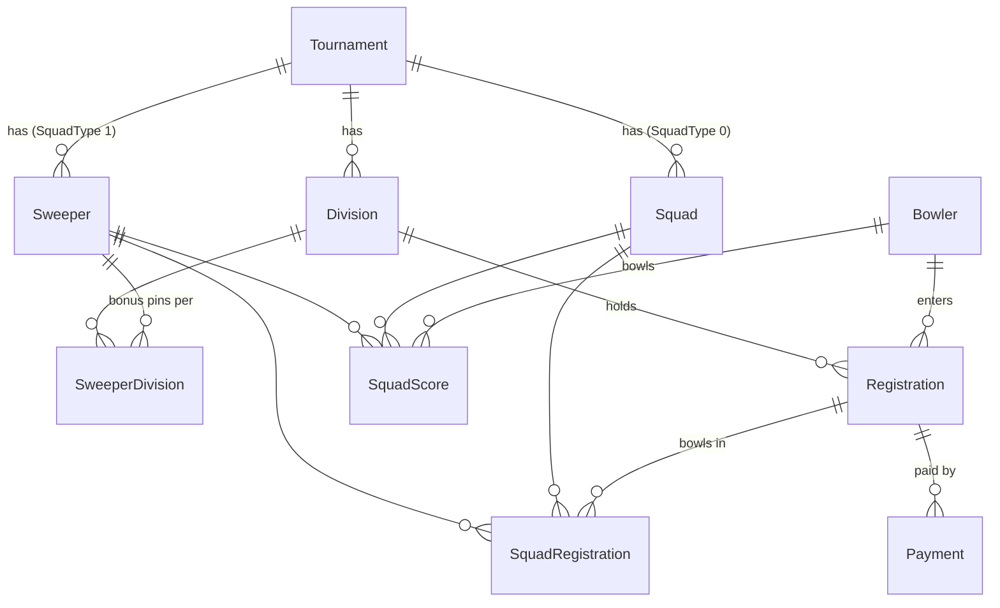
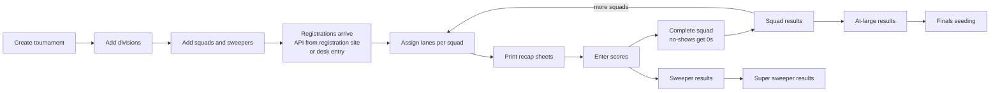

# Domain model

Field-level detail lives in each feature file and in [database.md](database.md). This page shows the shape.

## Entities

| Entity | One-line summary | Scope |
| --- | --- | --- |
| Tournament | Event settings: dates, fee, games, ratios, center | Global |
| Division | Bracket with handicap and eligibility rules | One tournament |
| Squad | Qualifying session; may override fee and ratios | One tournament |
| Sweeper | Side event with its own fee, games, cash ratio | One tournament |
| SweeperDivision | Bonus pins per game for one division in one sweeper | One sweeper |
| Bowler | A person. Reused across tournaments | Global |
| Registration | A bowler's entry into one division of one tournament | One tournament |
| SquadRegistration | A registration bowling one squad or sweeper, with lane position | One squad or sweeper |
| SquadScore | One game score for one bowler in one squad or sweeper | One squad or sweeper |
| Payment | A payment record against a registration | One registration |

## Key facts that shape everything

1. **One registration per bowler per tournament.** The bowler picks one division and enters one or more squads and sweepers under that registration. See `REG-01`. The database only enforces one per bowler per division; the code enforces one per tournament, and the scoring code depends on it.
2. **Squads and sweepers share one table** (`Squads`) and one join table (`SquadRegistration`) and one score table (`SquadScores`). A `SquadType` column tells them apart.
3. **Scores link to the bowler, not the registration.** `SquadScores` has `BowlerId` and `SquadId`. The division for a score comes from the bowler's registration in that tournament.
4. **Results are never stored.** Advancers, cashers, at-large, and seeds are computed on every request from scores. Only the scores and the "complete" flags are saved.
5. **Handicap is never stored.** It is computed from the registration's average and the division's settings each time.
6. **Legacy has no edit or delete** for tournaments, divisions, squads, or sweepers. It can only add them. Registrations and bowlers can be edited.

## Lifecycle of a tournament

Finals themselves (the stepladder or bracket) happen outside the app. The app ends at the seeding list.

## The .NET to Node map for this domain

| Legacy (.NET) | New app (Node/React) |
| --- | --- |
| Strongly typed IDs (`BowlerId`, `SquadId`, ...) wrapping `Guid` | Branded string types over UUIDs, if wanted (see `typescript-standards` skill) |
| `SmartEnum` `Gender` | A string union in TypeScript; map to the stored int at the repository |
| `ErrorOr` results and `ErrorDetail` | `HttpError` for expected failures (see `docs/api-standards.md`) |
| FluentValidation validators | Zod schemas plus plain functions for cross-field rules |
| EF Core table-per-hierarchy for squads | One table, a discriminator column, two TypeScript types |
