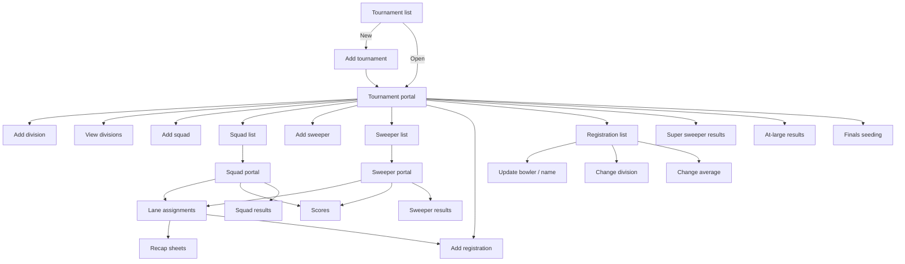

# Screens

The WinForms screens and what each does. Use this to plan the new app's pages, not to copy the layout.

Source: `main/` (forms), `presentation/` (presenters).

| Screen | What it does | Rules |
| --- | --- | --- |
| Tournament list | Start screen. Grid of all tournaments. New, Open | `TRN-11` |
| Add tournament | Form for every tournament field | `TRN-01` to `TRN-09` |
| Tournament portal | Menu hub for one tournament | |
| Add division | Division form; handicap percent entered as a whole percent | `DIV-01` to `DIV-11` |
| View divisions | List of divisions | `DIV-12` |
| Add squad | Date and time, fee, ratios, lanes, max per pair | `SQD-01` to `SQD-08` |
| Squad list / sweeper list | Pick a session to open its portal | |
| Add sweeper | Sweeper form plus a bonus-pins box per division | `SQD-10` to `SQD-13` |
| Squad portal / sweeper portal | Menu: lane assignments, scores, results, complete | `SQD-15`, `SQD-16` |
| Add registration | Pick or create bowler (search dialog first), then division, squads, sweepers, super sweeper, average | `REG-01` to `REG-08`, `PAY-01a` |
| Bowler search dialog | Find a bowler by name or email; "new bowler" option | `BWL-14` |
| Registration list | All registrations with counts; context menu actions | `REG-15` to `REG-25` |
| Update bowler info | Every bowler field, including SSN entry and verify | `BWL-01` to `BWL-17` |
| Update bowler name | Name fields only | `BWL-16` |
| Change division | Division, average, gender, date of birth, USBC ID | `REG-15` |
| Change average | Average only | `REG-16` |
| Lane assignments | Drag bowlers to positions; add, remove; copy; recap sheets; staggered-skip option | `LAN-*`, `REG-20` to `REG-22` |
| Recap sheets | One sheet per bowler with the cross; slider to page; print | `RPT-05` |
| Scores | Grid of positions × games; paste from clipboard; save | `SCR-01` to `SCR-15` |
| Squad results | One table per division; save PDF, print | `RES-02` to `RES-11b` |
| Sweeper results / super sweeper results | One table; save PDF, print | `RES-22` to `RES-29a` |
| At-large results | One table per division; save PDF, print | `RES-12` to `RES-17` |
| Finals seeding | One table per division; save PDF, print | `RES-18` to `RES-21a` |
| Confirm sensitive info | Retype an SSN to check it | `BWL-17`, `SEC-10` |

## Screen behavior worth keeping

- Long actions show a wait cursor; errors show in a message box; success shows a short message ("Registration added", "Scores updated", "Squad successfully completed").
- Destructive actions confirm first (delete registration, remove from squad, complete squad, add or remove super sweeper).
- In the new app these map to `Toast` (errors stay until dismissed; success closes itself) and a confirm dialog. See `docs/frontend-standards.md`.
